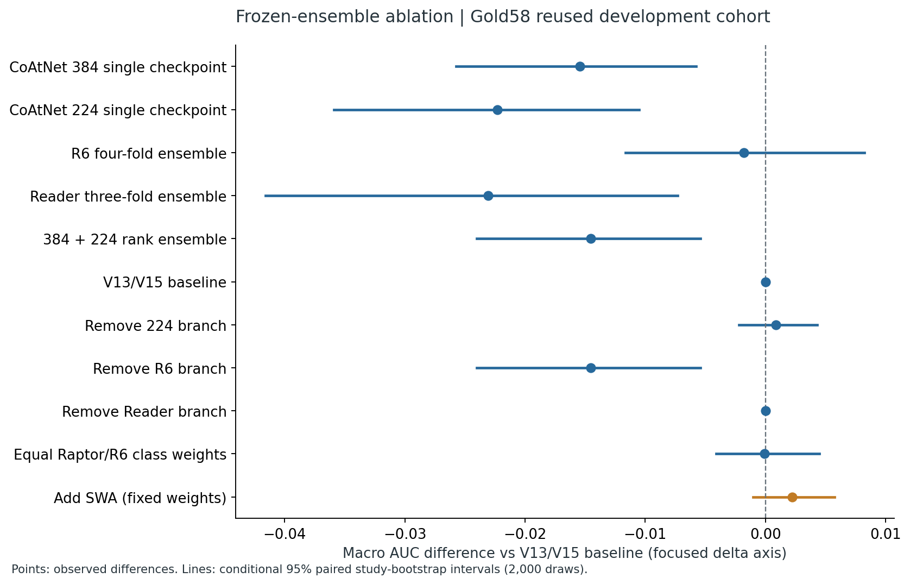
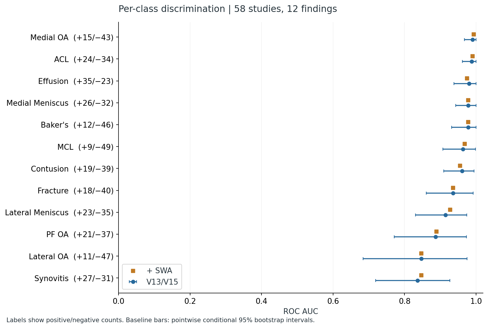

# RSNA Knee Research: Beyond the Leaderboard

**A retrospective ablation and per-class evaluation of Xinyi Lu's RSNA Knee Abnormality Detection pipeline.**

[中文说明](README.zh-CN.md) · [Executed research notebook](notebooks/research_audit.ipynb) · [Methods](docs/METHODS.md) · [Findings and limitations](docs/FINDINGS.md)

The account's best verified **public leaderboard score is 0.958**. This repository asks a different question: which branches contribute to discrimination, which findings remain difficult, and how much evidence supports the latest SWA addition?

The analysis uses **58 studies with complete official labels for 12 findings**, cached predictions from an actual Kaggle T4 ×2 run, and **2,000 paired study-bootstrap resamples**. It reconstructs the production fusion and verifies its scores against the saved outputs. No new training or image inference was performed for this retrospective analysis.

## Main results

| Frozen variant | Gold58 macro ROC AUC | Change vs baseline | Conditional 95% paired interval for change |
|---|---:|---:|---:|
| V13/V15 production recipe | 0.938369 | — | — |
| Remove R6 | 0.923816 | −0.014553 | [−0.024026, −0.005397] |
| Remove 224 branch | 0.939222 | +0.000853 | [−0.002200, +0.004294] |
| Remove Reader | 0.938369 | 0.000000 | [0.000000, 0.000000] |
| Equal Raptor/R6 class weights | 0.938298 | −0.000072 | [−0.004094, +0.004470] |
| Add kawaharataishi SWA, fixed weights | 0.940595 | +0.002226 | [−0.001006, +0.005772] |

These are **reused development-set results**, not independent validation or private leaderboard scores. The SWA checkpoint was retained after an earlier four-candidate screen on these same studies. Its interval crosses zero, and the bootstrap does not correct that selection bias. The V16 competition submission was still pending when the score receipt was collected; see the timestamp in [competition_provenance.json](results/competition_provenance.json).



- R6 contributes the largest observed gain among the tested branch removals.
- The Reader changes 30 study-label rank cells, but **no positive-negative pair ordering** in Gold58. Consequently, all 12 AUCs remain unchanged when it is removed. This does not establish that it is unnecessary on a larger cohort.
- The lowest baseline class AUCs are **Synovitis: 0.836320**, **Lateral OA: 0.847195**, and **PF OA: 0.886744**.
- SWA improves six class AUCs, worsens two, and ties four. Its largest gains are Lateral Meniscus (+0.013665) and Synovitis (+0.010753); Effusion (−0.004969) and Contusion (−0.005398) decline.



## Completed experiments

1. **Ablation:** 18 fixed variants covering individual checkpoints, fold ensembles, branch removal, class weights, and all four screened extra checkpoints. Every computed AUC is independently checked against scikit-learn.
2. **Per-class evaluation:** AUC with uncertainty, positive/negative counts, Recall, precision, specificity, FP/FN counts, and aggregate false-negative co-occurrence. Recall uses a fixed percentile-rank cutoff ≥0.5; these scores are uncalibrated and this is a descriptive operating point.
3. **Split/provenance audit:** Gold labels match the official training table. The historical local adapter train/dev split has no study overlap, no Gold58 membership, and no normalized-report overlap. The official table has **no stable patient identifier**, so patient separation of the current public checkpoints cannot be verified. One normalized report hash is shared between Gold58 and other official studies; that is a duplication signal, not proof of patient overlap.
4. **Supplementary view sensitivity:** 11 archived Apex preprocessing recipes, with the full 21-configuration archive retained as aggregate results. This uses an **older model family**. It covers resolution, FOV, slice count, offset and flip; it does not establish noise or intensity robustness of V13/V15.
5. **Efficiency evidence:** actual per-candidate wall time from the matched 58-study screen. SWA costs about 2.42 seconds per study within that harness. This is not isolated latency, a GPU-memory comparison, or an end-to-end speedup claim.

## Reproduce

```bash
python -m pip install -r requirements.txt
python -m unittest discover -s tests -v
python scripts/render_figures.py
python -m jupyter nbconvert --execute --to notebook --inplace notebooks/research_audit.ipynb
```

The notebook and figures regenerate from **public aggregate CSV/JSON files**. Recomputing study-level metrics requires authorized access to the private cached predictions:

```bash
python scripts/evaluate.py --data-dir /path/to/authorized/v16-output --output-dir results
python scripts/audit_split.py --official-train-csv /path/to/train.csv \
  --gold-targets-csv /path/to/v16_gold_targets.csv \
  --local-split-json /path/to/historical/split.json --output results/leakage_audit.json
```

See [DATA_ACCESS.md](docs/DATA_ACCESS.md) for the required filenames, source links and input hashes. Private medical images, reports, study identifiers, individual predictions, model weights and credentials are **not included** in this public repository.

## Repository map

| Path | Content |
|---|---|
| `src/rsna_research/` | Tie-aware AUC, paired bootstrap, operating-point metrics and frozen production fusion |
| `scripts/` | Metric evaluation, split audit, legacy sensitivity, figure rendering |
| `notebooks/research_audit.ipynb` | Executed research narrative with public aggregate tables and figures |
| `results/` | Aggregate results, input hashes, environment, score receipts and audit outcomes |
| `figures/` | PNG and SVG figures |
| `docs/` | Methods, interpretation, attribution, data-access and follow-up protocol |
| `tests/` | Metric, bootstrap and rank-fusion checks |

## Attribution and scope

The pretrained checkpoints and original inference pipelines come from **nartaa, heliosli/rostigor, goodpjw2008, kawaharataishi**, and the other authors listed in [ATTRIBUTION.md](docs/ATTRIBUTION.md). This repository's contribution is the reproducible retrospective evaluation, uncertainty analysis, split audit, and research interpretation. It does not claim to have trained those public models or reproduce an author's medal placement.

Research use only; these experiments do not validate a clinical diagnostic system. See [the next independent-validation protocol](docs/NEXT_EXPERIMENT.md) for what would strengthen the evidence.
